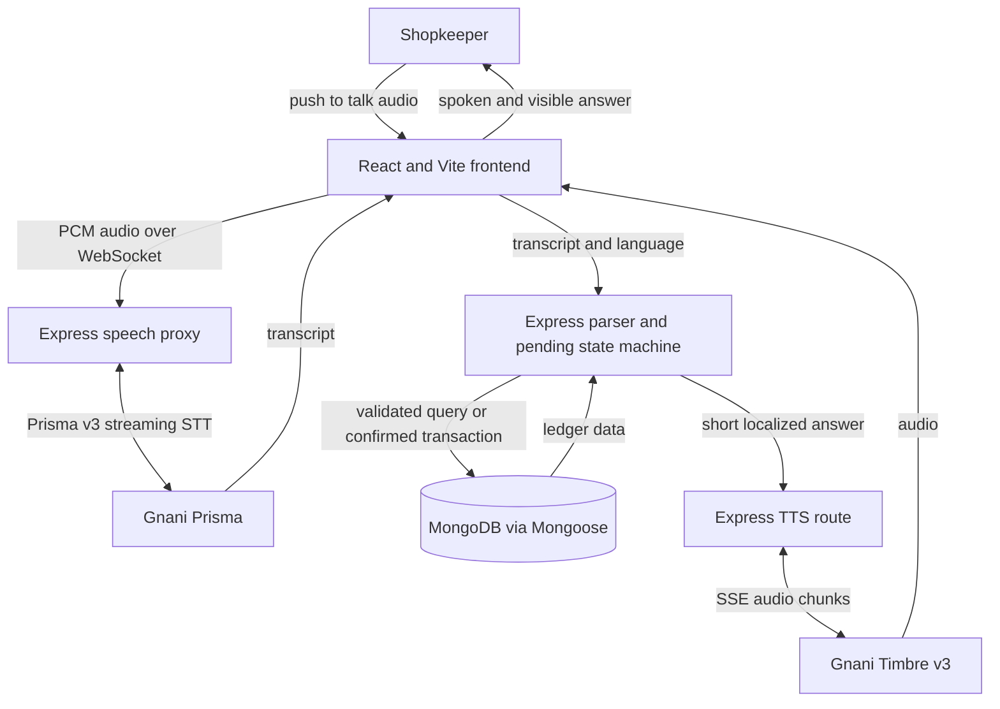

# Voice Khata for Kirana Stores

A voice first digital ledger prototype for recording customer credit and payments, checking balances, and asking simple daily ledger questions while running a busy shop.

## Problem statement

Kirana shopkeepers often track informal credit in paper notebooks. A voice interface can reduce the time spent opening a ledger and entering a sale, while explicit confirmation helps prevent a misheard name or amount from becoming a financial record.

## Solution overview

The shopkeeper uses push to talk in the React app. Gnani Prisma streams a transcript through the backend. The Express parser resolves an intent, customer, amount, and relative date. Transaction changes stay in a short lived pending state until the shopkeeper confirms. MongoDB remains the source of balances and totals. Short responses are sent to Gnani Timbre, with browser speech synthesis as a fallback.

## Features

- Customer and transaction ledger with credit and payment directions.
- Hindi, English, and Kannada language selection.
- Streaming Gnani Prisma speech recognition through a backend WebSocket proxy.
- Numeric and selected spoken number forms, including English, Hindi transliteration, Hindi script, and common Kannada transliteration.
- Pending transaction correction, spoken confirmation, cancellation, five minute expiry, and a persistent unique idempotency key for voice saves.
- Duplicate short customer names trigger a selection step; the selected MongoDB customer ID is used for the transaction.
- Relative dates for today, yesterday, and day before yesterday. Ambiguous “kal/parso” is clarified.
- Customer balance, highest outstanding balance, daily credit, and daily payment questions use MongoDB ledger data.
- Timezone aware daily totals, configured with `SHOP_TIMEZONE` (defaults to `Asia/Kolkata`).
- First interaction disclosure in the selected language, generated speech with browser fallback, and visible recording/processing/confirmation feedback.
- Client and backend latency measurements that log durations without transcripts or customer details.

## Supported languages and limitations

The app offers Hindi (`hi-IN`), Indian English (`en-IN`), and Kannada (`kn-IN`). Prisma v3 documents support for additional Indian languages and code switching, but this interface and its parser are currently limited to those three choices. The number word dictionaries cover common shop phrases, not every dialect or number form. Unrecognized, multiple, or ambiguous amounts and dates ask for clarification. Noise robustness depends on the microphone, browser audio path, network, and Gnani recognition; parser logic cannot fix an incorrect transcript.

Kannada and Hindi response phrases are included, but the project has not been validated with native speaker listening tests. Confirm the chosen Timbre voice and browser fallback on the actual demo devices before presenting. The two second response target has not been proven; it must be judged from live measurements with the configured Gnani service and network.

## Technology and architecture

- Frontend: React 19 and Vite 8.
- Backend: Node.js, Express 5, Mongoose 8, and `ws`.
- Database: MongoDB.
- Speech recognition: Gnani Prisma v3 streaming WebSocket (`wss://api.vachana.ai/stt/v3/stream`).
- Speech generation: Gnani Timbre v3 SSE (`https://api.vachana.ai/api/v1/tts/sse`), with browser speech synthesis fallback.



The transcript is returned to the browser and submitted to the command route. It is not stored in MongoDB or printed in backend logs. Voice pending state is held in one backend process for up to five minutes; a server restart safely discards an unconfirmed request. The unique transaction idempotency key protects against duplicate voice saves after retries.

## Setup

Requirements: Node.js 20.19+ (or 22.12+), MongoDB, and a Gnani API key with Prisma and Timbre access. Microphone access requires localhost or HTTPS in supported browsers.

### 1. Configure the backend

In PowerShell from the project root:

```powershell
Set-Location backend
if (-not (Test-Path .env)) { Copy-Item .env.example .env }
notepad .env
npm.cmd install
npm.cmd run dev
```

Fill the local `.env` with your own values. Do not commit it or paste it into an issue.

```dotenv
MONGODB_URI=mongodb://127.0.0.1:27017/voice-khata
GNANI_API_KEY=replace_with_your_gnani_key
PORT=5000
SHOP_TIMEZONE=Asia/Kolkata
FRONTEND_ORIGIN=http://localhost:5173,http://127.0.0.1:5173
```

For MongoDB Atlas, use the URI from your own cluster and permit the backend host. Encryption at rest is controlled by the MongoDB deployment; it cannot be confirmed from this repository. Verify that setting in the cluster/provider console.

### 2. Start the frontend

Open a second PowerShell terminal:

```powershell
Set-Location C:\Users\Devidas\Downloads\voice-khata\frontend
npm.cmd install
npm.cmd run dev
```

Open the Vite URL, normally `http://localhost:5173`. The Vite development proxy forwards `/api` and its WebSocket to `http://localhost:5000`.

Optional frontend deployment settings are shown in `frontend/.env.example`. For a separate production frontend and API, set `VITE_API_URL` and `VITE_WS_URL`, set backend `FRONTEND_ORIGIN`, and use HTTPS/WSS at the public endpoints.

For an Android device, use a deployed HTTPS URL or an HTTPS development tunnel. Browsers generally block microphone access from an unsecured LAN IP page. Add the exact page origin to `FRONTEND_ORIGIN` before testing.

### Environment variable reference

| Variable | Used by | Purpose |
| --- | --- | --- |
| `MONGODB_URI` | Backend | MongoDB connection string. |
| `GNANI_API_KEY` | Backend only | Gnani Prisma and Timbre API authentication. Never expose it as a `VITE_` variable. |
| `PORT` | Backend | API and WebSocket port; defaults to `5000`. |
| `SHOP_TIMEZONE` | Backend | IANA timezone for relative dates and daily totals; defaults to `Asia/Kolkata`. |
| `FRONTEND_ORIGIN` | Backend | Comma separated browser origins allowed by CORS and the WebSocket upgrade. |
| `VITE_API_URL` | Frontend build | API base URL, including `/api`; defaults to the same origin `/api`. |
| `VITE_WS_URL` | Frontend build | Optional speech WebSocket URL; defaults to same origin `/api/voice/stream`. |

## Gnani integrations

The backend keeps the Gnani key in `GNANI_API_KEY`. `/api/voice/stream` proxies live PCM frames to Prisma v3 using the `x-api-key-id`, language, sample-rate, and transcription-format headers. The client does not receive the key. Prisma output arrives over the streaming connection; application parsing and MongoDB queries happen after the transcript is submitted to `/api/voice/command`.

`/api/tts` calls Gnani's SSE endpoint with `model: timbre-v3.0` and the existing preset voice `Yashraj`, then returns audio to the browser. This project does not call Gnani voice cloning. The frontend falls back to the browser's `speechSynthesis` if the request or playback fails. The current route collects the SSE audio before returning it, so its playback latency includes the full TTS response. Gnani's published API information describes streaming recognition and SSE speech output; network and provider time remain outside this app's control ([Prisma v3](https://www.gnani.ai/resources/prisma-v3), [Timbre API](https://www.gnani.ai/text-to-speech-api)).

## Voice workflow

1. On the first recording in each selected language, the app introduces itself as the Voice Khata AI assistant.
2. The shopkeeper presses **Start recording**, speaks, and presses **Stop recording**.
3. The transcript appears for review. **Process command** checks the intent and actual ledger data.
4. For a transaction, the backend creates a five minute pending request. Similar customer matches require an explicit selection.
5. The shopkeeper can say a correction such as “Nahi, chaar sau tees,” then review and confirm the updated amount. Saying “No” or “Cancel” cancels the pending entry. No change is written before confirmation.
6. The unique idempotency key makes a repeated confirmation safe. Pending requests live only in process memory; a backend restart expires them rather than saving them.
7. Spoken answers and transaction results also appear on screen. The dashboard displays credit and payment totals for the configured local day.

## Run checks

From the backend directory:

```powershell
npm.cmd test
```

From the frontend directory:

```powershell
npm.cmd run build
npm.cmd run lint
```

The automated backend suite covers amount extraction, intent direction, correction state, customer matching, date resolution, timezone day boundaries, and daily total calculations. The repository does not include live MongoDB/Gnani integration tests; those require configured services and synthetic demo data.

## Privacy and security

- `.env` files are ignored by Git; Gnani credentials remain on the backend.
- Backend error logs omit request transcripts, API response bodies, customer names, and credentials. Voice metrics contain durations and intent labels only.
- Transcripts are used in the current browser session and command request only; no transcript collection or retention job is configured. Clearing the browser session removes the displayed transcript. Ledger records are separate and are never removed by transcript cleanup.
- API request bodies are size limited and customer IDs, transaction types, and positive bounded amounts are validated. Duplicate customer names are never selected arbitrarily.
- CORS and WebSocket origin checks use `FRONTEND_ORIGIN`. These checks do not replace user authentication; keep the prototype on a trusted network until authentication and authorization are added.
- Confirm MongoDB encryption at rest with the selected MongoDB provider. Use TLS for MongoDB, HTTPS for the site, and WSS for speech in production.
- Use synthetic or properly consented customer data for judging. Do not add customer reminders without opt-in consent. The prototype does not send reminders or use coercive payment language.
- There is no transcript file to delete after judging. Remove any screenshots or recordings that contain real customer data, and clean synthetic demo ledger entries only when appropriate for that demo database.

## Screenshots

Add current, synthetic-data screenshots before publishing. Suggested files:

- `docs/screenshots/dashboard.png`
- `docs/screenshots/voice-confirmation.png`
- `docs/screenshots/daily-totals.png`

No screenshots are included yet.

## Demo video

Placeholder: `[Add the 2–3 minute demo video link here]`.

## Demo and pitch preparation

See [the demo script and six-slide pitch outline](docs/DEMO_SCRIPT.md). Do not present a response time or accuracy number until a live measurement has been collected from the configured environment.

## Known limitations and next steps

- No user login or role-based access control; this is a trusted-network prototype, not a public production service.
- Pending conversations live in memory and are not shared across backend instances. Use a shared TTL-backed store before horizontal scaling.
- Live Gnani, database failure, WebSocket disconnect, TTS fallback, and microphone permission recovery still need demo-device integration checks.
- The test suite is unit focused; there is no configured MongoDB or Gnani integration test environment in this repository.
- Supported number words and relative date phrases are intentionally finite. Hindi “kal” and “parso” can be ambiguous, and the app asks the shopkeeper rather than guessing.
- The current TTS handler buffers its SSE response before returning audio. Latency is measured, but the two-second target is not verified.
- The Timbre request does not pin a provider language code; localized text is sent as-is and browser fallback uses the selected locale. Verify generated Hindi, English, and Kannada audio on demo devices.
- Native speaker review is needed for Hindi and Kannada prompts, number pronunciation, and fallback voices on Android browsers.
- Future improvements: persistent pending state with TTL, authenticated users, full integration tests, broader numeral and dialect coverage, streaming browser playback, configurable consent/retention controls, and on-device low-connectivity support.
